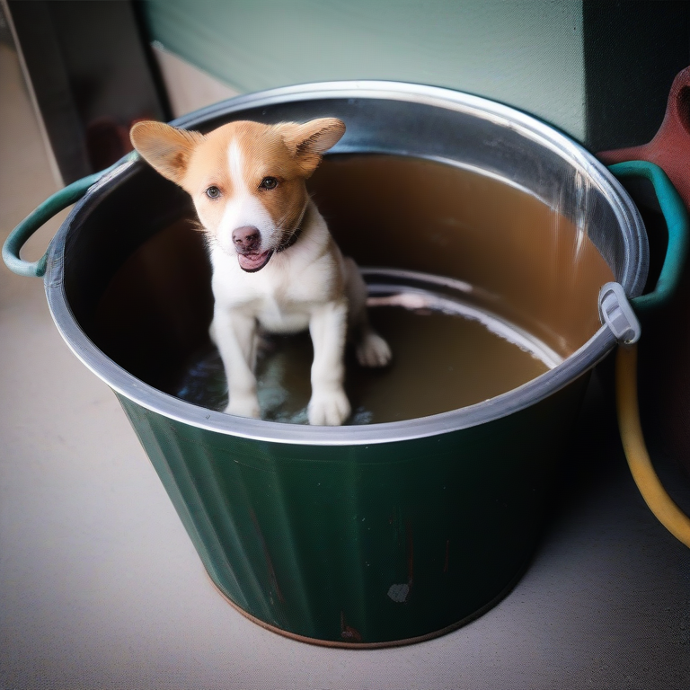
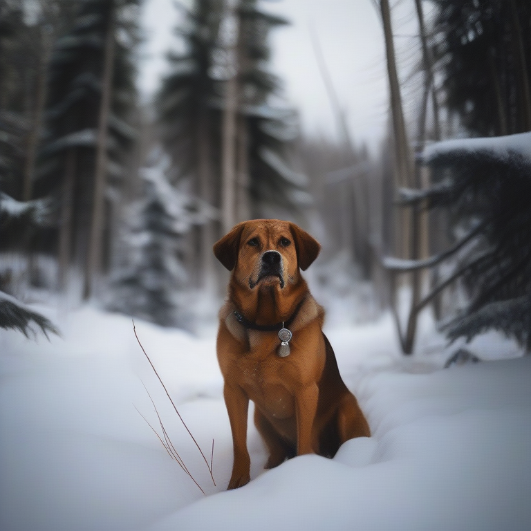
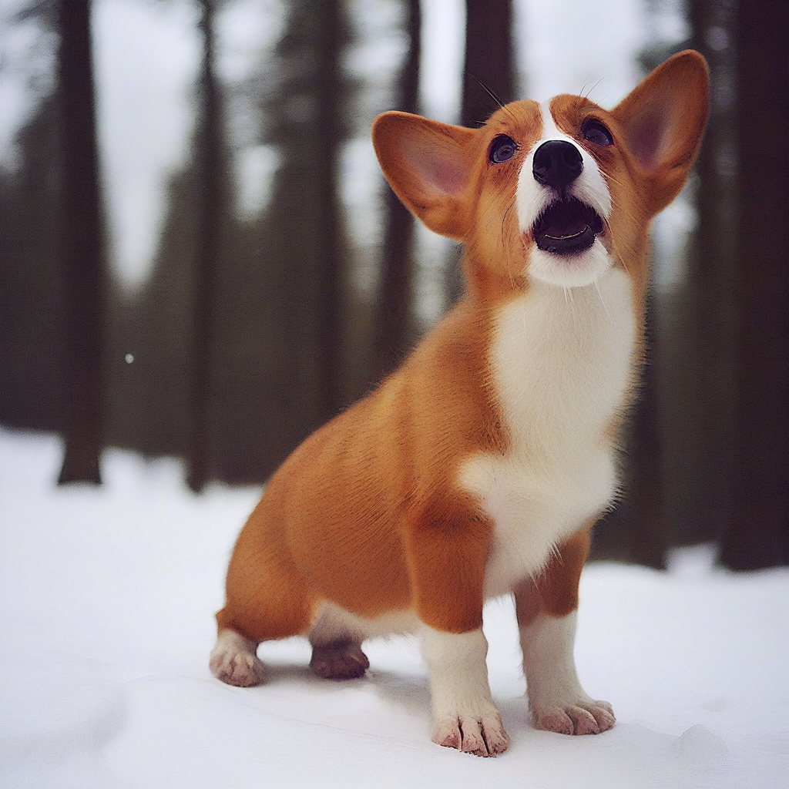
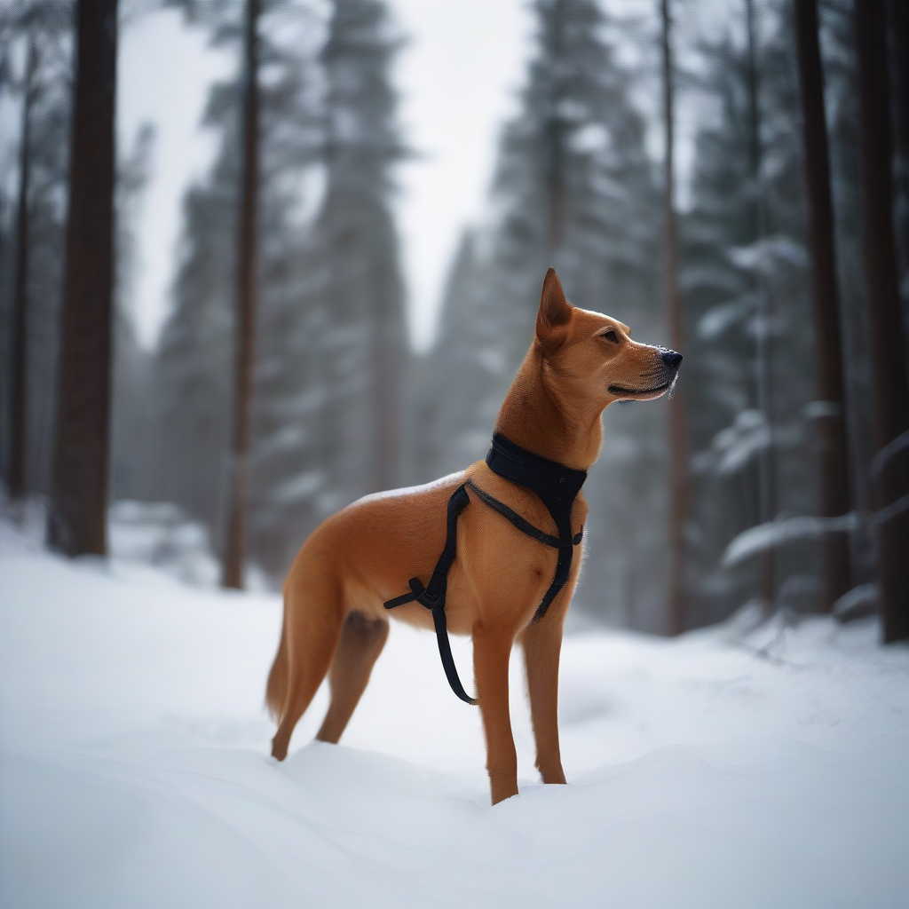

**English** | [한국어](README.ko.md)

# SDXL LoRA training on Vulkan — no CUDA, no ROCm (v0.1)

**Train SDXL LoRAs on an AMD GPU without ROCm.** This project implements SDXL UNet training (forward, backward and AdamW) on top of [ggml](https://github.com/ggml-org/ggml) and runs it with **plain Vulkan**, so it works on GPUs that ROCm does not support, including integrated graphics. It was developed and tested on an **AMD Radeon 660M iGPU** (6 CUs, shared system memory).

- No CUDA, no ROCm, no PyTorch at training time: a single C++ binary using the ggml Vulkan backend
- Output is a standard **kohya-format LoRA** (`.safetensors`) that loads in stable-diffusion.cpp and other tools
- Trains up to **1024px** (SDXL native resolution) with gradient checkpointing in about 8.5 GiB of GPU-visible memory
- Gradients verified against PyTorch (float64) and UNet outputs verified against stable-diffusion.cpp

> The code and documentation in this repository were written by a Claude agent (Anthropic); the human author set the goals, made the decisions and judged the results. The full design log, including the mistakes, is in [for_ai.md](for_ai.md) (Korean).

## Results

Training: [diffusers/dog-example](https://huggingface.co/datasets/diffusers/dog-example), 5 images, caption `a photo of sks dog`, 384px, rank 8.
Generation: stable-diffusion.cpp (Vulkan), 768px, 20 steps, cfg 7, **same seed, without / with the LoRA**.

| Prompt | Without LoRA | With LoRA |
|---|---|---|
| `a photo of sks dog in a bucket` |  |  400 steps |
| `a photo of sks dog on a sunny beach` |  |  600 steps, weight 0.7 |
| `a photo of sks dog in a snowy forest` |  |  600 steps |

The trained dog (big ears, white stripe on the face) appears while the scene in the prompt (bucket, beach, snowy forest) is still followed.

### 1024px training (SDXL native resolution)
Same data, **1024px, 200 steps** (`--ckpt --native all`, f32), generated at 1024px with sd.cpp, same seed.

| Prompt | Without LoRA | With LoRA (1024px, f32) |
|---|---|---|
| `a photo of sks dog in a bucket` |  |  |
| `a photo of sks dog in a snowy forest` |  |  |

Training took 3.76 hours (57–69 s/step), about 8.5 GiB of GPU + system memory in total, no NaNs.

### fp16 matmul training: do not use (v0.1)
With fp16 matrix multiplication (without `GGML_VK_DISABLE_F16`) training is 1.4× faster, has no NaNs and the loss looks the same as f32, but **the LoRA barely learns**: 486 of 560 modules keep their up-weights at exactly zero and the generated images look like the base model (snowy forest: ).
The cause is **gradient underflow** in fp16 (the loss gradient is so small that it falls below the fp16 range). v0.1 has no loss scaling, so **always set `GGML_VK_DISABLE_F16=1`** (the server does this by default). Details: `for_ai.md` 1.8 and `verification/`.

### Accuracy
- Reduced SDXL-style UNet: LoRA gradients match PyTorch (float64 reference) with relative error **1e-6 on CPU / 3e-6 on Vulkan**
- Full SDXL UNet output matches stable-diffusion.cpp to **2.3e-4** (the level of sd.cpp's f16 im2col), also with a LoRA applied
- Gradient checkpointing gradients = full-graph gradients (**8e-7**)

### Speed / memory (Radeon 660M, Mesa 25.0.7 RADV, f32, rank 8, batch 1)
| Resolution | Mode | s/step | GPU memory (incl. 4.9 GiB weights) |
|---|---|---|---|
| 384 | no checkpointing | 6.3 | ~8.0 GiB |
| 512 | `--ckpt` | 12.4 | ~5.5 GiB |
| 768 | `--ckpt` | 28.7 | ~6.6 GiB |
| **1024** | `--ckpt` | **57.5** (~69 in long runs) | **~8.2 GiB** |

In the real 1024px run the step time rose by about 15% after 20–40 steps and stayed there (not seen in a 1-hour 384px run; temperature and clocks were normal; cause unknown).

Verification artifacts (logs, all generated images, reference data) are in [`verification/`](verification/README.md). The trained LoRA files are not distributed; the commands to train them yourself under the same conditions are in [`verification/README.md`](verification/README.md#학습한-lora-재현).

## Requirements
- Linux with a Vulkan 1.3 GPU driver (verified on AMD RADV). About 9 GiB or more of GPU-usable memory (for an iGPU, check the GTT size)
- CMake 3.19+, a C++17 compiler, `glslc` (for ggml's Vulkan shaders)
- SDXL base checkpoint (`sd_xl_base_1.0.safetensors`) and VAE (`sdxl-vae-fp16-fix` recommended)
- `sd-cli` from [stable-diffusion.cpp](https://github.com/leejet/stable-diffusion.cpp) (a version with DGL mode), used to build the training cache and to check results
- Python 3 (the cache script uses only the standard library). The verification tests need PyTorch, NumPy and `gguf`

Other Vulkan GPUs (other AMD cards, Intel Arc, NVIDIA via Vulkan) should work in principle but have not been tested. Reports are welcome.

## Build
```sh
patches/get_ggml.sh ggml                 # fetch ggml (eeda9ec4) and apply this project's patch
cmake -S . -B build -DCMAKE_BUILD_TYPE=Release -DGGML_DIR=ggml
cmake --build build -j4                  # build/sdxl_lora, build/sdxl_lora_server, build/tinyunet
```
Prebuilt x86-64 Linux binaries (`sdxl_lora`, `sdxl_lora_server`) are in [Releases](../../releases) (ggml statically linked, built on glibc 2.41). Runtime requirements: `libvulkan1`, `libgomp1`, `libstdc++6` and your GPU's Vulkan driver. On distributions with an older glibc, build from source.
Build dependencies (Debian/Ubuntu): `build-essential cmake git glslc libvulkan-dev spirv-headers`. More on building, usage and troubleshooting: [for_ai.md](for_ai.md) 1.11–1.20.

## Usage

### 1. Build the data cache (images → latents, captions → text conditioning)
Only the UNet is in the training graph. The VAE and text encoders are run once in advance with sd.cpp and saved as `.npy`.
```sh
# image folder: image files + optional .txt captions with the same name. Center-cropped to a square and resized to --size
python3 tools/make_cache.py dataset/dog cache/dog1024 --size 1024 --caption "a photo of sks dog" \
    --sd-cli /path/to/sd-cli --model models/sd_xl_base_1.0.safetensors --vae models/sdxl_vae.safetensors \
    --vae-backend cpu    # 1024px VAE encoding uses a lot of GPU memory, CPU recommended
```
Output: `<name>.latent.npy`, `<name>.crossattn.npy`, `<name>.vector.npy`, a preview `<name>.check.png`, and `captions.txt`

### 2. Train (CLI)
```sh
GGML_VK_DISABLE_F16=1 build/sdxl_lora --train cache/dog1024 --ckpt --native all \
    --steps 200 --lr 1e-4 --rank 8 --alpha 8 --save-every 100 --out out/dog_lora.safetensors
```
| Option | Description |
|---|---|
| `--train <dir>` | cache folder (all samples must have the same resolution) |
| `--ckpt` | gradient checkpointing (per-block recomputation). Required at 768px and above, about 1.3× slower |
| `--native all` | use ggml's native NORM/GROUP_NORM/GEGLU/CONCAT/UPSCALE with the new backward rules (less memory, **recommended**). Without it, a composite-op version is used |
| `--steps --lr --rank --alpha --seed` | training settings. LoRA targets: to_q/k/v/out of every attn1/attn2 (560 modules) |
| `--save-every N` | intermediate saves `<out>_s<step>.safetensors` |
| `--resume <lora>` | continue training (with `--lr 0`: fixed-seed loss evaluation) |
| `--t-min/--t-max` | timestep range (default 0..999) |
| `--model <ckpt>` | SDXL checkpoint (default `models/sd_xl_base_1.0.safetensors`) |
| `--backend vulkan\|cpu` | default vulkan |

- `GGML_VK_DISABLE_F16=1`: run matrix multiplication in f32. **Required.** Without it fp16 matmul is used, which is 1.4× faster but the LoRA barely learns because of gradient underflow (see "fp16 matmul training" above)
- The output LoRA is kohya format (`lora_unet_<block>_attn1_to_q.lora_down.weight` / `.lora_up.weight` / `.alpha`)

### 3. Train (server)
An HTTP job manager that runs the CLI as a child process. One job at a time; when training ends the process exits and the GPU memory is released.
```sh
build/sdxl_lora_server --root /path/to/workdir --port 8090     # uses sdxl_lora from the same folder (or --cli)
curl -X POST localhost:8090/api/train -d '{"data":"cache/dog1024","out":"out/dog.safetensors","steps":200,"save_every":100}'
curl localhost:8090/api/status       # step, loss, ema, sec_per_step, eta_sec, log_tail
curl -X POST localhost:8090/api/stop
curl -O localhost:8090/files/out/dog.safetensors
```
Open `http://localhost:8090/` in a browser for a progress page. Paths in requests are restricted to `--root`. **There is no authentication, so only listen on the default 127.0.0.1.**
`/api/train` JSON keys: `data out steps lr rank alpha seed save_every ckpt (default true) native (default "all") resume model fp16 (default false, **do not enable**: the LoRA will not learn) t_min t_max`

### 4. Check the result (generate with sd.cpp)
```sh
SD_CLI=/path/to/sd-cli LORA_DIR=out tools/eval_prompt.sh beach "a photo of sks dog on a sunny beach" dog 0   # without LoRA
SD_CLI=/path/to/sd-cli LORA_DIR=out tools/eval_prompt.sh beach "a photo of sks dog on a sunny beach" dog 1   # with LoRA
python3 tools/gallery.py out/eval     # index.html with the same prompts side by side
```
To use it directly with sd-cli: `--lora-model-dir out -p "...<lora:dog:1>" --lora-apply-mode at_runtime` (about 2 GiB less memory than the default merge mode).

### 5. Verification / diagnostic tools
| Command | What it does |
|---|---|
| `build/tinyunet tests/tiny8.gguf [--backend vulkan] [--native all]` | compares the forward pass and LoRA gradients of a reduced UNet with a PyTorch reference (generate it with `python3 tests/ref_tiny_unet.py --out tests/tiny8.gguf --size 8`). `--compare`: per-op Vulkan vs CPU error |
| `sdxl_lora --check-ref <dir> [--lora x]` | compares the real SDXL UNet output with an sd.cpp reference (made by running `tools/ref_unet.dgl` with `sd-cli -M dgl`) |
| `sdxl_lora --train <dir> --grad-check` | checks checkpointing gradients = full-graph gradients (compared at step 2) |
| `sdxl_lora --mem-plan <latent side> [--ckpt] [--native all]` | computes training-graph memory without a GPU (64 = 512px, 128 = 1024px) |
| `SDXL_NAN_DEBUG=1 sdxl_lora --train ... --steps N` | finds the first node that produces a non-finite value at step N |
| `tools/guard.sh <log> <cmd>` | memory guard for iGPUs: kills the command when GTT + system used exceeds `GUARD_LIMIT_MIB` |

## Known limitations (v0.1)
- Batch size 1, a single square resolution (no aspect-ratio buckets), UNet attention LoRA only (no text-encoder or conv LoRA)
- **fp16 matmul training does not work**: without loss scaling the gradients underflow and the LoRA barely learns (verified). Always use f32 (`GGML_VK_DISABLE_F16=1`)
- Step time increases by about 15% in long 1024px runs (cause unknown)
- stable-diffusion.cpp `sd-cli` is needed for the data cache and for checking results
- Only one GPU has been verified: Radeon 660M (RADV)

## Layout
```
src/unet_ggml.h        SDXL-style UNet graph builder (block API, shared with the reduced test model)
src/sdxl_io.h          safetensors/npy I/O, SDXL discrete noise schedule
src/cli/sdxl_lora.cpp  trainer (training, checkpointing, verification modes, kohya export)
src/server/server.cpp  HTTP job manager
tests/                 reduced-UNet check against PyTorch
tools/                 cache, evaluation, gallery, memory guard, header/npy viewers
patches/               ggml changes (backward rules, Vulkan kernels) + fetch script
for_ai.md              design log and rationale (detailed, Korean)
```

## License
[MIT](LICENSE) © 2026 [banghak005-wq](https://github.com/banghak005-wq). You may use, modify and redistribute it, including commercially, as long as the copyright notice is kept.
`patches/` (ggml changes), `third_party/json.hpp`, `third_party/httplib.h` and the third-party code in the released binaries remain under their original authors' licenses. See [THIRD_PARTY_LICENSES.md](THIRD_PARTY_LICENSES.md) for the list and full license texts.
