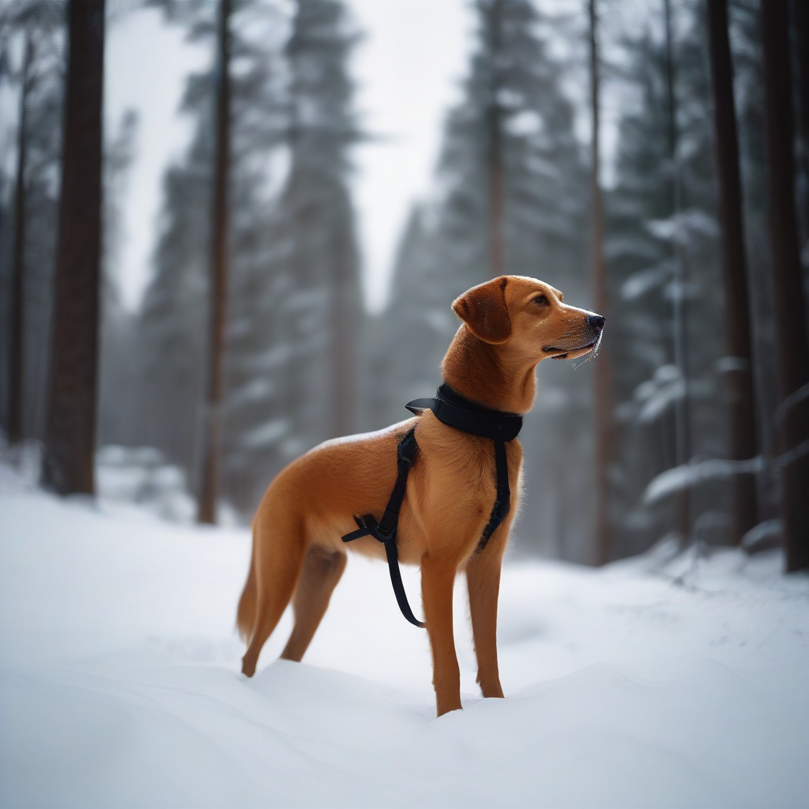

# SDXL LoRA 학습 on Vulkan (ROCm/CUDA 없이) — v0.1

**SDXL LoRA training with plain Vulkan (no ROCm, no CUDA), tested on an AMD Radeon 660M iGPU (6 CU, shared memory).**

ggml 위에 SDXL UNet 학습(순전파 + 역전파 + AdamW)을 직접 구현해, ROCm을 지원하지 않는 내장 GPU에서 Vulkan만으로
SDXL LoRA를 학습한다. 결과 LoRA는 kohya 형식 safetensors라 stable-diffusion.cpp 등 일반 도구에 바로 걸 수 있다.

## 결과

학습: [diffusers/dog-example](https://huggingface.co/datasets/diffusers/dog-example) 5장, 캡션 `a photo of sks dog`, 384px, rank 8.
생성: stable-diffusion.cpp (Vulkan), 768px, 20스텝, cfg 7, **같은 seed로 LoRA 없음 / 있음** 비교.

| 프롬프트 | LoRA 없음 | LoRA 있음 |
|---|---|---|
| `a photo of sks dog in a bucket` |  |  400스텝 |
| `a photo of sks dog on a sunny beach` |  |  600스텝, 가중치 0.7 |
| `a photo of sks dog in a snowy forest` |  |  600스텝 |

학습한 강아지(큰 귀, 흰 줄무늬 얼굴)가 나오면서 프롬프트의 장면(양동이, 해변, 눈숲)도 따른다.

### 1024px (SDXL 표준 해상도) 학습
같은 데이터로 **1024px, 200스텝**(`--ckpt --native all`, f32) 학습 → sd.cpp로 1024px 생성, 같은 seed.

| 프롬프트 | LoRA 없음 | LoRA 있음 (1024px f32) |
|---|---|---|
| `a photo of sks dog in a bucket` |  |  |
| `a photo of sks dog in a snowy forest` |  |  |

학습 3.76시간 (스텝당 57~69초), GPU+시스템 메모리 합계 약 8.5GiB, NaN 없음.

### fp16 행렬곱 학습: 쓰지 말 것 (v0.1)
같은 조건에서 fp16 행렬곱(`GGML_VK_DISABLE_F16` 없이)으로 학습하면 1.4배 빠르고 NaN도 없고 손실도 f32와 비슷하지만, **LoRA가 거의 학습되지 않는다** — up 가중치가 정확히 0으로 남은 모듈 486/560, 생성 결과는 LoRA 없는 것과 거의 같다 (눈숲: ).
원인은 fp16에서의 **기울기 언더플로**(손실 기울기가 매우 작아 fp16 최소값 아래로 떨어짐). 손실 스케일링이 없는 v0.1에서는 **반드시 `GGML_VK_DISABLE_F16=1`**(서버는 기본값). 상세: `for_ai.md` 1.8, `verification/`.

### 정확도
- 축소판 SDXL형 UNet: LoRA 기울기가 PyTorch(float64 정답)와 **CPU 1e-6 / Vulkan 3e-6** 상대오차로 일치
- 실제 SDXL UNet 출력: stable-diffusion.cpp와 **2.3e-4** (sd.cpp 쪽 f16 im2col 수준 차이), LoRA를 건 상태도 같음
- 그래디언트 체크포인팅 기울기 = 체크포인팅 없는 기울기 (**8e-7**)

### 속도 / 메모리 (Radeon 660M, Mesa 25.0.7 RADV, f32, rank 8, 배치 1)
| 해상도 | 모드 | s/스텝 | GPU 메모리 (가중치 4.9GiB 포함) |
|---|---|---|---|
| 384 | 체크포인팅 없음 | 6.3 | 약 8.0 GiB |
| 512 | `--ckpt` | 12.4 | 약 5.5 GiB |
| 768 | `--ckpt` | 28.7 | 약 6.6 GiB |
| **1024** | `--ckpt` | **57.5** (오래 돌리면 약 69) | **약 8.2 GiB** |

1024px 실제 학습에서는 20~40스텝쯤부터 스텝 시간이 약 15% 늘어 유지됐다 (384px 1시간 학습에선 없었음, 발열·클럭은 정상, 원인 미확정).

검증 결과물(로그, 생성 이미지 전체, 기준 데이터)은 [`verification/`](verification/README.md). 학습한 LoRA 파일은 배포하지 않는다 — 같은 조건으로 직접 학습하는 명령은 [`verification/README.md`](verification/README.md#학습한-lora-재현).

## 요구 사항
- Linux, Vulkan 1.3 GPU 드라이버 (AMD RADV에서 검증). GPU가 쓸 수 있는 메모리 약 9GiB 이상 (iGPU면 GTT 크기 확인)
- CMake 3.19+, C++17 컴파일러, `glslc` (ggml Vulkan 셰이더 빌드)
- SDXL base 체크포인트 (`sd_xl_base_1.0.safetensors`), VAE (`sdxl-vae-fp16-fix` 권장)
- [stable-diffusion.cpp](https://github.com/leejet/stable-diffusion.cpp)의 `sd-cli` (DGL 모드 지원 버전): 학습 데이터 캐시와 결과 확인에 사용
- Python 3 (캐시 스크립트는 표준 라이브러리만 씀). 검증 테스트는 PyTorch, NumPy, `gguf`

## 빌드
```sh
patches/get_ggml.sh ggml                 # ggml(eeda9ec4) 받기 + 이 프로젝트 수정분 적용
cmake -S . -B build -DCMAKE_BUILD_TYPE=Release -DGGML_DIR=ggml
cmake --build build -j4                  # build/sdxl_lora, build/sdxl_lora_server, build/tinyunet
```
빌드된 x86-64 Linux 실행 파일(`sdxl_lora`, `sdxl_lora_server`)은 [Releases](../../releases)에 있다 (ggml 정적 링크, glibc 2.41에서 빌드). 실행에 필요한 시스템 라이브러리: `libvulkan1`, `libgomp1`, `libstdc++6` + GPU의 Vulkan 드라이버. glibc가 더 오래된 배포판이면 소스에서 빌드.
빌드 의존(Debian/Ubuntu): `build-essential cmake git glslc libvulkan-dev spirv-headers`. 빌드·사용·문제 해결의 상세는 [for_ai.md](for_ai.md) 1.11~1.20.

## 사용법

### 1. 데이터 캐시 (이미지 → 잠재값, 캡션 → 텍스트 조건)
학습 그래프에는 UNet만 들어간다. VAE/텍스트 인코더는 sd.cpp로 미리 한 번 돌려 `.npy`로 저장한다.
```sh
# 이미지 폴더: 그림 파일 + (선택) 같은 이름의 .txt 캡션. 가운데를 정사각형으로 잘라 --size로 줄인다
python3 tools/make_cache.py dataset/dog cache/dog1024 --size 1024 --caption "a photo of sks dog" \
    --sd-cli /path/to/sd-cli --model models/sd_xl_base_1.0.safetensors --vae models/sdxl_vae.safetensors \
    --vae-backend cpu    # 1024px VAE 인코딩은 GPU 메모리를 많이 써서 CPU 권장
```
결과: `<이름>.latent.npy`, `<이름>.crossattn.npy`, `<이름>.vector.npy`, 확인용 `<이름>.check.png`, `captions.txt`

### 2. 학습 (CLI)
```sh
GGML_VK_DISABLE_F16=1 build/sdxl_lora --train cache/dog1024 --ckpt --native all \
    --steps 200 --lr 1e-4 --rank 8 --alpha 8 --save-every 100 --out out/dog_lora.safetensors
```
| 옵션 | 설명 |
|---|---|
| `--train <폴더>` | 캐시 폴더 (모든 샘플이 같은 해상도) |
| `--ckpt` | 그래디언트 체크포인팅 (블록 단위 재계산). 768px 이상은 필수, 약 1.3배 느림 |
| `--native all` | NORM/GROUP_NORM/GEGLU/CONCAT/UPSCALE를 ggml 원래 연산 + 새 역전파로 (메모리 절약, **권장**). 빼면 기본 연산 조합 버전 |
| `--steps --lr --rank --alpha --seed` | 학습 설정. LoRA 대상: 모든 attn1/attn2의 to_q/k/v/out (560 모듈) |
| `--save-every N` | 중간 저장 `<out>_s<스텝>.safetensors` |
| `--resume <lora>` | 이어서 학습 (`--lr 0`이면 고정 seed 손실 평가) |
| `--t-min/--t-max` | timestep 범위 (기본 0..999) |
| `--model <ckpt>` | SDXL 체크포인트 (기본 `models/sd_xl_base_1.0.safetensors`) |
| `--backend vulkan\|cpu` | 기본 vulkan |

- `GGML_VK_DISABLE_F16=1`: 행렬곱을 f32로. **필수.** 빼면 fp16 행렬곱이 되는데, 1.4배 빠르지만 기울기 언더플로로 LoRA가 거의 학습되지 않는다 (위 "fp16 행렬곱 학습" 참고)
- 출력 LoRA는 kohya 형식 (`lora_unet_<블록>_attn1_to_q.lora_down.weight` / `.lora_up.weight` / `.alpha`)

### 3. 학습 (서버)
CLI를 자식 프로세스로 돌리는 HTTP 작업 관리자. 한 번에 작업 하나, 학습이 끝나면 프로세스가 끝나 GPU 메모리가 반환된다.
```sh
build/sdxl_lora_server --root /path/to/workdir --port 8090     # 같은 폴더의 sdxl_lora를 씀 (--cli로 지정 가능)
curl -X POST localhost:8090/api/train -d '{"data":"cache/dog1024","out":"out/dog.safetensors","steps":200,"save_every":100}'
curl localhost:8090/api/status       # step, loss, ema, sec_per_step, eta_sec, log_tail
curl -X POST localhost:8090/api/stop
curl -O localhost:8090/files/out/dog.safetensors
```
브라우저로 `http://localhost:8090/`에 진행 상황 페이지. 요청의 경로는 `--root` 안으로 제한된다. **인증이 없으므로 기본값(127.0.0.1)으로만 열 것.**
`/api/train` JSON 키: `data out steps lr rank alpha seed save_every ckpt(기본 true) native(기본 "all") resume model fp16(기본 false, **켜지 말 것**: 학습 안 됨) t_min t_max`

### 4. 결과 확인 (sd.cpp로 생성)
```sh
SD_CLI=/path/to/sd-cli LORA_DIR=out tools/eval_prompt.sh beach "a photo of sks dog on a sunny beach" dog 0   # LoRA 없음
SD_CLI=/path/to/sd-cli LORA_DIR=out tools/eval_prompt.sh beach "a photo of sks dog on a sunny beach" dog 1   # LoRA 있음
python3 tools/gallery.py out/eval     # 같은 프롬프트를 나란히 놓은 index.html
```
sd-cli에 직접 걸 때는 `--lora-model-dir out -p "...<lora:dog:1>" --lora-apply-mode at_runtime` (미리 합치는 기본 방식보다 메모리 약 2GiB 적음).

### 5. 검증 / 진단 도구
| 명령 | 하는 일 |
|---|---|
| `build/tinyunet tests/tiny8.gguf [--backend vulkan] [--native all]` | 축소판 UNet의 순전파/LoRA 기울기를 PyTorch 정답과 비교 (정답은 `python3 tests/ref_tiny_unet.py --out tests/tiny8.gguf --size 8`로 생성). `--compare`: 연산별 Vulkan vs CPU 자체 오차 |
| `sdxl_lora --check-ref <폴더> [--lora x]` | 실제 SDXL UNet 출력을 sd.cpp 기준값과 비교 (기준값: `tools/ref_unet.dgl`을 `sd-cli -M dgl`로 실행) |
| `sdxl_lora --train <폴더> --grad-check` | 체크포인팅 기울기 = 전체 그래프 기울기 확인 (2번째 스텝에서 비교) |
| `sdxl_lora --mem-plan <잠재값 한 변> [--ckpt] [--native all]` | GPU 없이 학습 그래프 메모리 계산 (64 = 512px, 128 = 1024px) |
| `SDXL_NAN_DEBUG=1 sdxl_lora --train ... --steps N` | N번째 스텝에서 처음 비유한 값이 나오는 노드 찾기 |
| `tools/guard.sh <로그> <명령>` | iGPU용 메모리 감시: GTT + 시스템 used 합이 `GUARD_LIMIT_MIB`를 넘으면 명령 종료 |

## 알려진 제한 (v0.1)
- 배치 1, 정사각형 한 해상도 (비율 버킷 없음), UNet 어텐션 LoRA만 (텍스트 인코더/합성곱 LoRA 없음)
- **fp16 행렬곱 학습은 쓸 수 없음**: 손실 스케일링이 없어 기울기가 언더플로 → LoRA가 거의 학습 안 됨 (검증함). 반드시 f32(`GGML_VK_DISABLE_F16=1`)
- 1024px 장시간 학습에서 스텝 시간이 약 15% 늘어나는 현상 (원인 미확정)
- 학습 데이터 캐시와 결과 확인에 stable-diffusion.cpp `sd-cli`가 필요
- 검증한 GPU는 Radeon 660M (RADV) 하나

## 폴더
```
src/unet_ggml.h        SDXL형 UNet 그래프 빌더 (블록 단위 API, 검증용 축소판과 공유)
src/sdxl_io.h          safetensors/npy 입출력, SDXL 이산 노이즈 스케줄
src/cli/sdxl_lora.cpp  학습기 (학습, 체크포인팅, 검증 모드, kohya 저장)
src/server/server.cpp  HTTP 작업 관리자
tests/                 축소판 UNet PyTorch 대조 검증
tools/                 캐시, 평가, 갤러리, 메모리 감시, 헤더/npy 보기
patches/               ggml 수정분 (역전파 규칙, Vulkan 커널) + 받기 스크립트
for_ai.md              설계 과정과 근거 (AI/개발자용 상세 문서)
```

## 라이선스
[MIT](LICENSE) © 2026 [banghak005-wq](https://github.com/banghak005-wq). 저작권 표시만 유지하면 상업적 이용·수정·재배포 모두 자유.
`patches/`(ggml 수정분), `third_party/json.hpp`, `third_party/httplib.h`와 배포 실행 파일에 들어간 외부 코드는 각 원저작자의 라이선스를 따른다. 목록과 라이선스 전문은 [THIRD_PARTY_LICENSES.md](THIRD_PARTY_LICENSES.md).
