**English** | [한국어](README.ko.md)

# SDXL LoRA training on Vulkan — no CUDA, no ROCm (v0.3)

**Train SDXL LoRAs on an AMD GPU without ROCm.** This project implements SDXL UNet training (forward, backward and AdamW) on top of [ggml](https://github.com/ggml-org/ggml) and runs it with **plain Vulkan**, so it works on GPUs that ROCm does not support, including integrated graphics. It was developed and tested on an **AMD Radeon 660M iGPU** (6 CUs, shared system memory).

- No CUDA, no ROCm, no PyTorch at training time: a single C++ binary using the ggml Vulkan backend
- Output is a standard **kohya-format LoRA** (`.safetensors`) that loads in stable-diffusion.cpp and other tools
- Trains up to **1024px** (SDXL native resolution) with gradient checkpointing in about 8–9 GiB of GPU-visible memory
- Gradients verified against PyTorch (float64) and UNet outputs verified against stable-diffusion.cpp

> The code and documentation in this repository were written by a Claude agent (Anthropic); the human author set the goals, made the decisions and judged the results. The full design log, including the mistakes, is in [for_ai.md](for_ai.md) (Korean).

**New in v0.3: fp16 matmul training (loss scaling).** Up to v0.2, training with fp16 matrix multiplication silently failed (gradient underflow: the LoRA did not learn), so only f32 was usable.
v0.3 adds dynamic loss scaling, and **fp16 training now produces practically the same LoRA as f32, 1.33× faster** (1024px, 200 steps: LoRA direction similarity 0.999, near-identical images; see "v0.3 results").
It is enabled automatically when `GGML_VK_DISABLE_F16=1` is not set. f32 training (`GGML_VK_DISABLE_F16=1`) gives bit-identical results to v0.2.

v0.2 feature: **convolution LoRA (LoCon)**. `--conv-rank N` also puts LoRA on the ResBlock and down/upsampling convolutions (same rules and file format as kohya `conv_dim`).
Without the option it behaves exactly like v0.1 (verified: bit-identical training loss with the same seed).
Also in v0.2: fixed a measurement error that made `tools/guard.sh` (memory guard) kill healthy jobs inside LXC (see section 5 of Usage).

## v0.3 results: fp16 matmul training (loss scaling)
The experiment that failed in v0.2 (5 dog images, 1024px, 200 steps, seed 1, rank 8) was repeated in v0.3 **under the same conditions**. Generation: sd.cpp, 1024px, seed 42.

| Prompt | f32 training (v0.2) | fp16 without loss scaling (v0.2) | **fp16 + loss scaling (v0.3)** |
|---|---|---|---|
| `a photo of sks dog in a bucket` |  |  |  |
| `a photo of sks dog on a sunny beach` |  |  |  |
| `a photo of sks dog in a snowy forest` |  |  |  |

- v0.2 fp16: the trained corgi does not appear (looks like no LoRA). v0.3 fp16: **almost the same image as f32** (same subject and composition; only small differences such as ear angle or paw position)
- LoRA weights: v0.3 fp16 vs f32 up-weight direction similarity **0.999**, norm ratio 0.999, zero modules 0/560 (v0.2 fp16: similarity 0.000, zero modules 486/560)
- Mean loss 0.10518 (f32 0.1051), no NaNs and no overflows, 50.7 s/step (f32 about 67.7 s → **1.33× faster**), same memory as f32 (peak total 9.2 GiB)
- f32 training is bit-identical to v0.2 (the scale is a power of two, so it does not change f32 results)
- Details: `verification/logs/v03_*.txt`, `for_ai.md` 1.5, 1.8, 2.13

## v0.2 results: attention LoRA vs LoCon (same data, same seed, same training order)
5 dog images, rank 8, lr 1e-4. LoCon only adds `--conv-rank 8 --conv-alpha 8` (initialization, timesteps and noise order are matched with the attention-only run, so the only difference is the convolution LoRA).
Generation: sd.cpp (Vulkan), 20 steps, cfg 7, seed 42, `--lora-apply-mode at_runtime`, weight 1. Three training resolutions × attention / LoCon.

**Conclusion: on this data (learning a single subject) there is no evidence that LoCon is clearly better.** Both draw the trained subject and follow the scene in the prompt; which one wins differs per scene and per resolution (single-seed comparisons, treated as noise). LoCon costs 6–14% more training time. Texture- or style-heavy data may behave differently but was not tested.

| Training resolution (steps) | LoCon better | Attention better | Similar | Training s/step (attention → LoCon) | Mean loss (attention / LoCon) |
|---|---|---|---|---|---|
| 384px (600) | all 4, slightly (fur, body shape) | – | – | 6.34 → 6.70 (+6%) | 0.1101 / 0.1080 |
| 768px (300) | snowy forest | sks dog, bucket, beach (slightly) | – | 34.9 → 36.9 (+6%) | 0.0949 / 0.0946 |
| 1024px (200) | beach (colors) | bucket | snowy forest | 67.7 → 77.3 (+14%) | 0.1051 / 0.1049 |

- At every resolution all 66 convolution-side modules learned (up-weight norms ≈ attention, zero modules 0/626). The attention LoRA inside LoCon has direction similarity 0.91 (384) / 0.97 (768) / 0.98 (1024) with the attention-only LoRA
- **Applying only the convolution part** (the 768px LoCon with attention keys removed, 66 convolution modules only, `verification/lora_filter.py nonattn`): colors, texture and scene change, but the trained corgi does not appear (`sks dog` → a white labrador , bucket → a different dog ). **The subject's identity is learned by the attention LoRA; the convolution LoRA changes texture and color**, which is why LoCon helped little for subject training
- **Training resolution matters far more than LoCon**: the 384px LoRAs strongly carry over the orange background of the training photos, while the 768/1024px LoRAs produce natural scenes (tables below)
- Peak total memory: 384px (no checkpointing) 9.2 GiB, 768px 7.1 GiB, 1024px 9.2 GiB (`--ckpt`)

**768px LoRAs** (generated at 768px):

| Prompt | Attention | LoCon |
|---|---|---|
| `a photo of sks dog` | 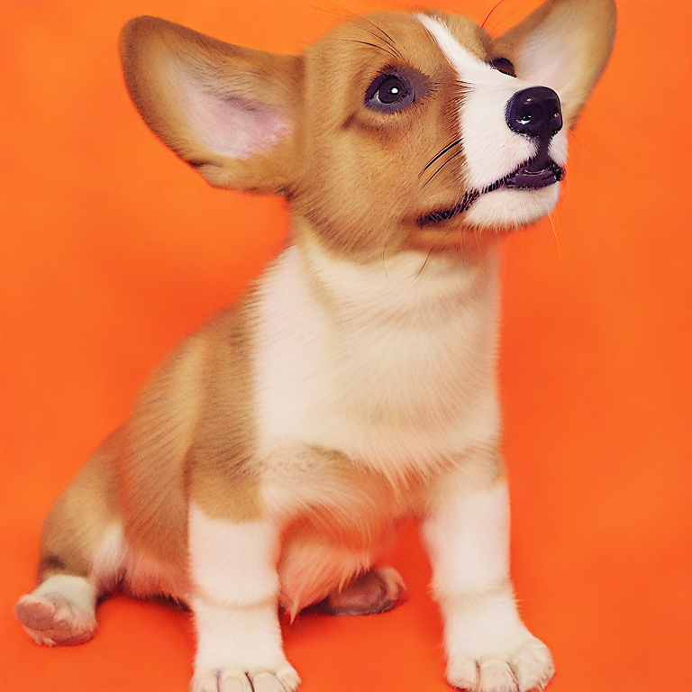 |  |
| `... in a bucket` |  |  |
| `... on a sunny beach` |  | 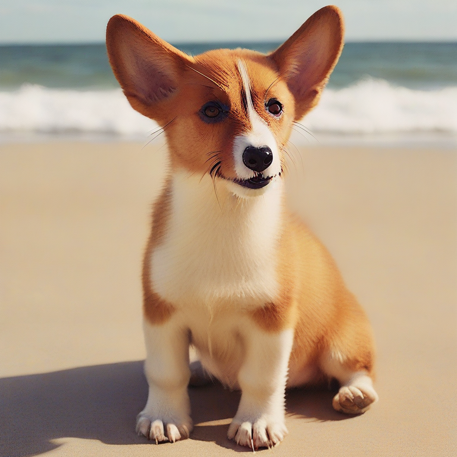 |
| `... in a snowy forest` |  |  |

**1024px LoRAs** (generated at 1024px; attention = the v0.1 LoRA):

| Prompt | Attention | LoCon |
|---|---|---|
| `... in a bucket` |  |  |
| `... in a snowy forest` |  | 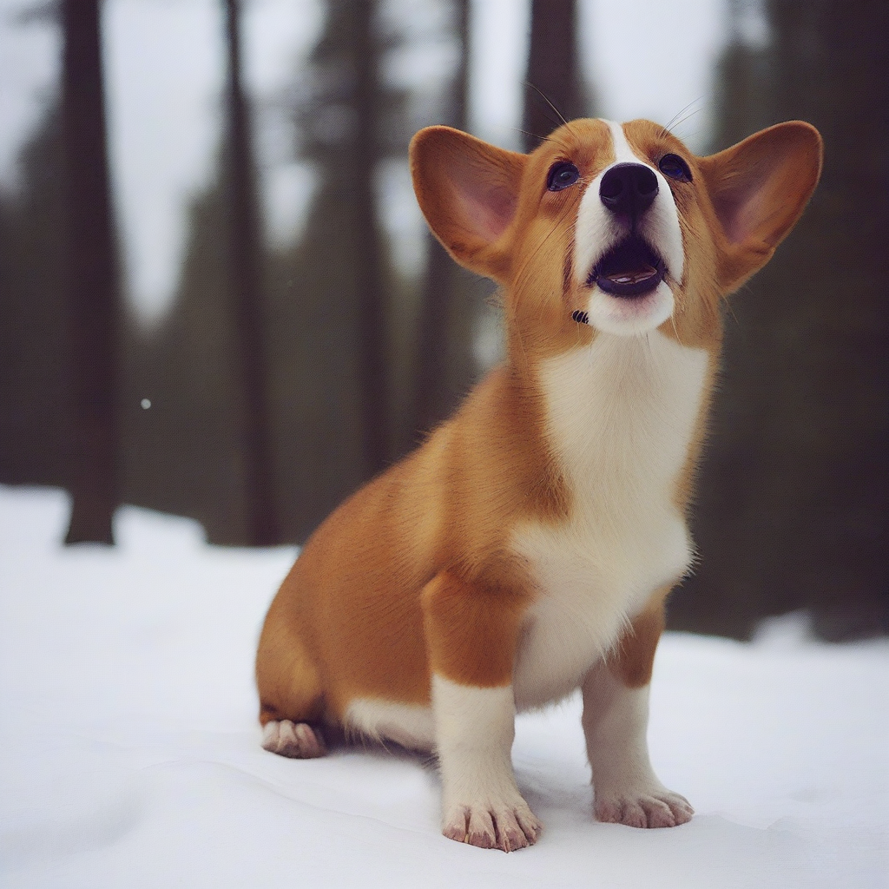 |
| `... on a sunny beach` |  |  |

**384px LoRAs** (generated at 768px, with the no-LoRA baseline):

| Prompt | Without LoRA | Attention LoRA (v0.1) | LoCon (v0.2) |
|---|---|---|---|
| `a photo of sks dog` |  | 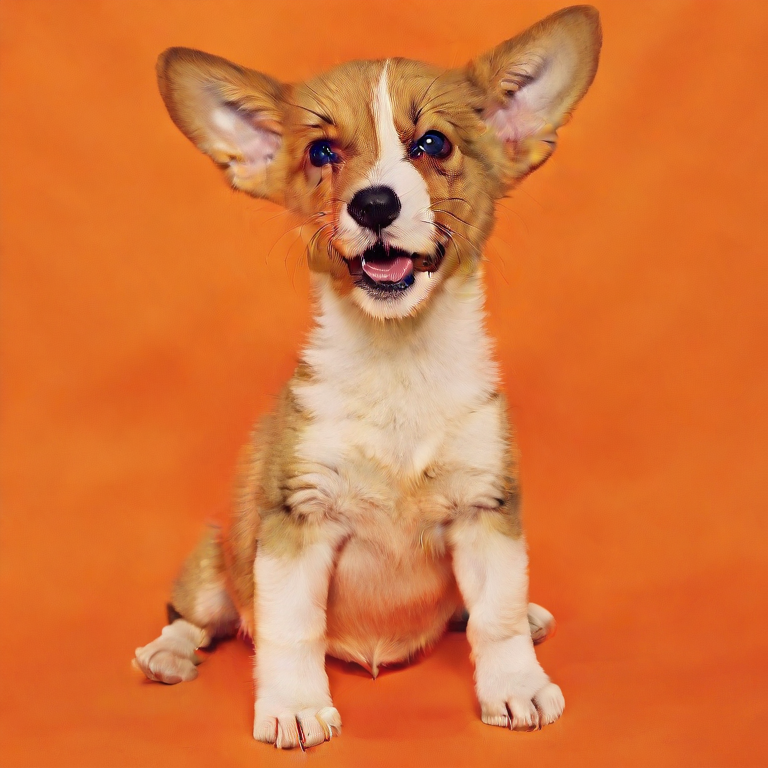 | 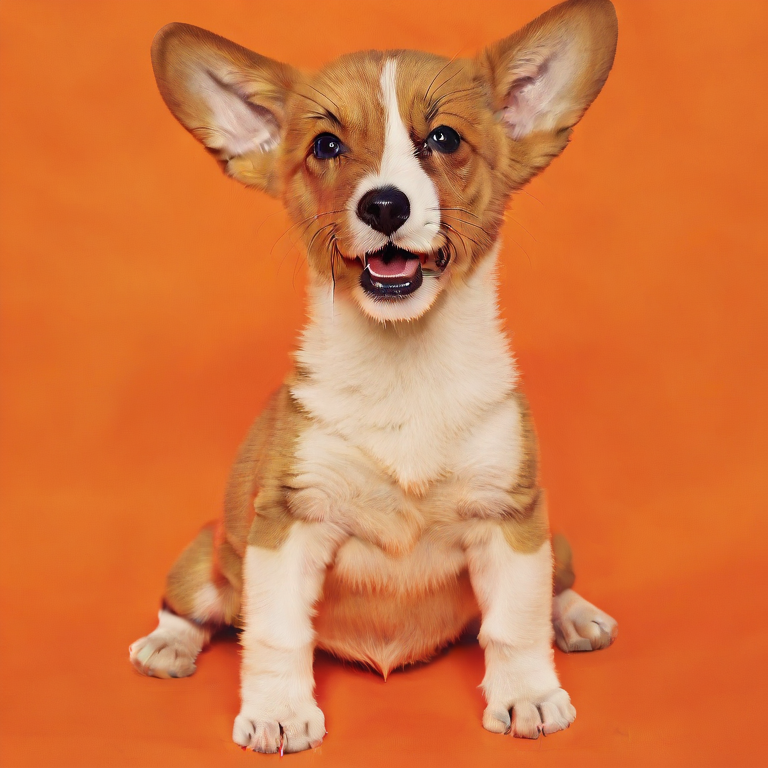 |
| `a photo of sks dog in a bucket` |  |  | 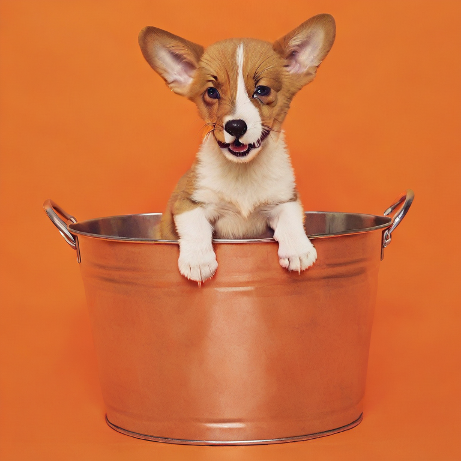 |
| `a photo of sks dog on a sunny beach` | 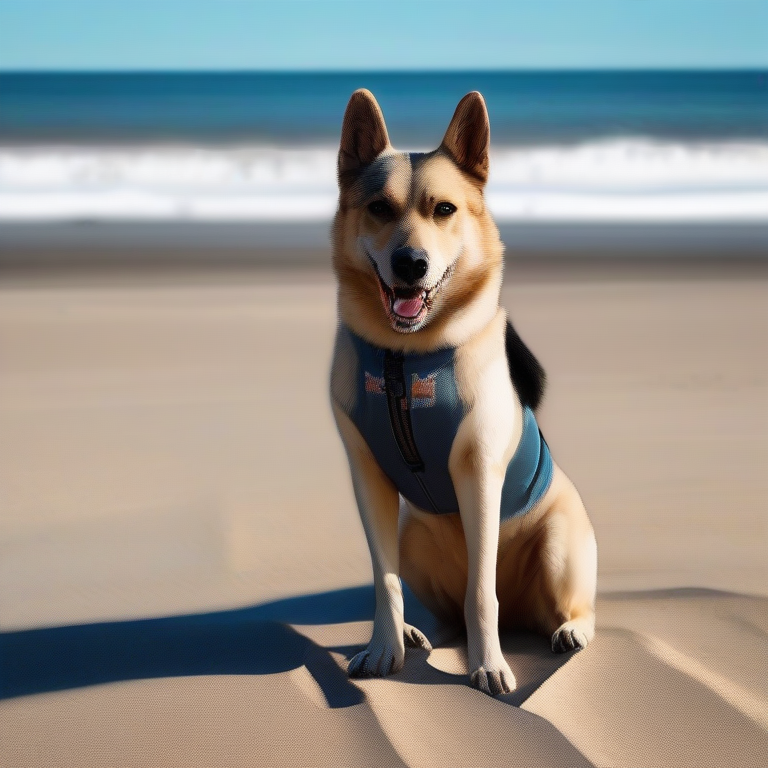 |  |  |
| `a photo of sks dog in a snowy forest` |  |  | 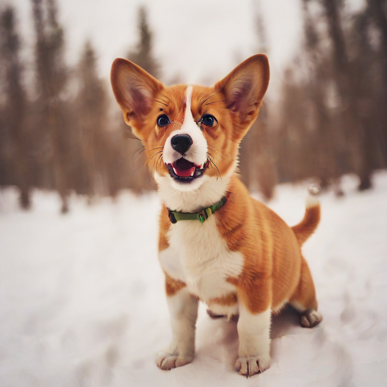 |

**384px LoRAs generated at 1024px** (about 11 min per image, peak total memory about 8.9 GiB):

| Prompt | Attention LoRA (v0.1) | **LoCon (v0.2)** |
|---|---|---|
| `a photo of sks dog in a bucket` |  |  |
| `a photo of sks dog in a snowy forest` |  |  |
| `a photo of sks dog on a sunny beach` | 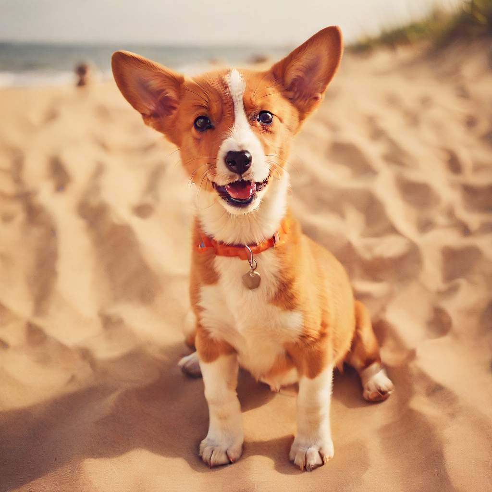 |  |

- The snowy forest shows the largest difference: the attention version turns the whole frame red (color bleeding of the 384px LoRA, seen in v0.1), while the LoCon version keeps the snow and trees whiter and sharper. Shapes such as the bucket handle are also more intact with LoCon. Both still overfit to the orange background and reddish tones (a limit of 5 images at 384px)
- Weight 0.7 (768px beach): . Same composition as the attention version at 0.7 (v0.1 results below), less overfitting and more natural than weight 1

- Cost (at 384px): parameters 11.6M → 14.9M, step time 6.34 → 6.70 s (+6%), peak total memory 8.85 → 9.19 GiB, file size 47 → 60 MB


## v0.1 results (attention LoRA, reproduced unchanged in v0.2)

Training: [diffusers/dog-example](https://huggingface.co/datasets/diffusers/dog-example), 5 images, caption `a photo of sks dog`, 384px, rank 8.
Generation: stable-diffusion.cpp (Vulkan), 768px, 20 steps, cfg 7, **same seed, without / with the LoRA**.

| Prompt | Without LoRA | With LoRA |
|---|---|---|
| `a photo of sks dog in a bucket` |  |  400 steps |
| `a photo of sks dog on a sunny beach` |  | 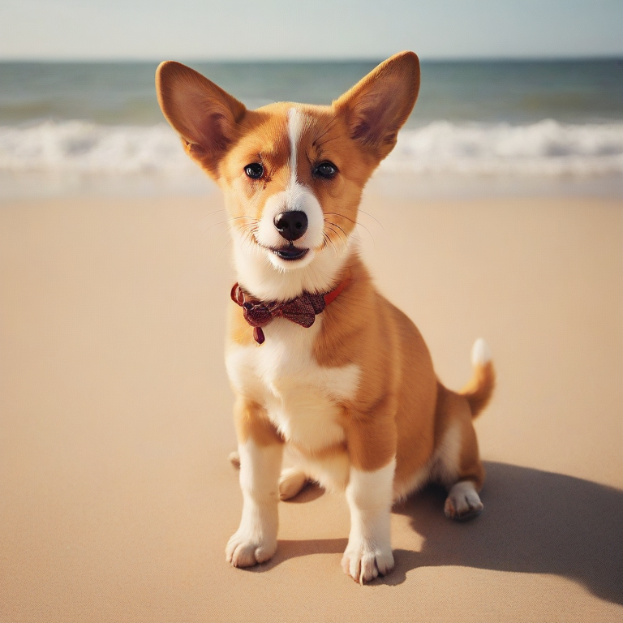 600 steps, weight 0.7 |
| `a photo of sks dog in a snowy forest` |  | 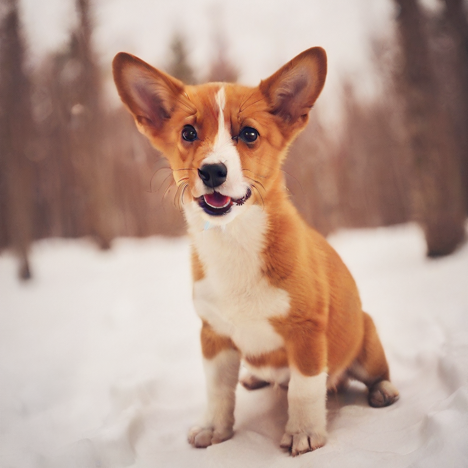 600 steps |

The trained dog (big ears, white stripe on the face) appears while the scene in the prompt (bucket, beach, snowy forest) is still followed.

### 1024px training (SDXL native resolution)
Same data, **1024px, 200 steps** (`--ckpt --native all`, f32), generated at 1024px with sd.cpp, same seed.

| Prompt | Without LoRA | With LoRA (1024px, f32) |
|---|---|---|
| `a photo of sks dog in a bucket` | 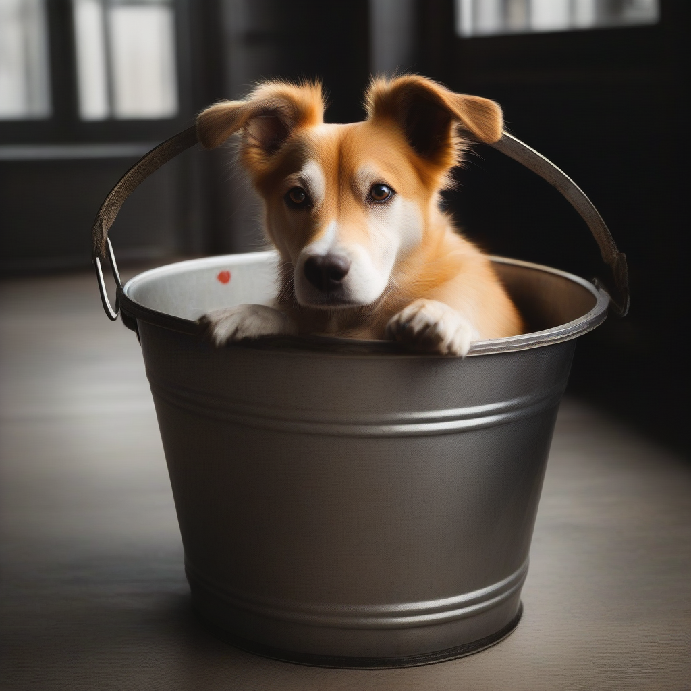 |  |
| `a photo of sks dog in a snowy forest` |  |  |

Training took 3.76 hours (57–69 s/step), about 8.5 GiB of GPU + system memory in total, no NaNs.

### fp16 matmul training (up to v0.2: failed → v0.3: fixed with loss scaling)
Up to v0.2, training with fp16 matrix multiplication (without `GGML_VK_DISABLE_F16`) had no NaNs and a loss similar to f32, but **the LoRA barely learned**: 486 of 560 modules kept their up-weights at exactly zero and the generated images looked like the base model.
The cause is **gradient underflow** (the loss gradient is so small that it falls below the fp16 range and becomes zero). The loss scaling added in v0.3 fixes this (see "v0.3 results").

### Accuracy
- Reduced SDXL-style UNet: LoRA gradients match PyTorch (float64 reference) with relative error **1e-6 on CPU / 3e-6 on Vulkan**
- Full SDXL UNet output matches stable-diffusion.cpp to **2.3e-4** (the level of sd.cpp's f16 im2col), also with a LoRA applied
- Gradient checkpointing gradients = full-graph gradients (**8e-7**)
- **v0.2 LoCon**: reduced-model gradients vs PyTorch 1.7e-6 on CPU / 3.3e-6 on Vulkan, full SDXL output vs sd.cpp **2.39e-4** (removing the convolution LoRA gives 1.1e-2, 48× larger, so the comparison really checks the convolution contribution), sd.cpp loads 1878/1878 keys, checkpointing gradients 6.2e-7

### Speed / memory (Radeon 660M, Mesa 25.0.7 RADV, f32, rank 8, batch 1)
| Resolution | Mode | s/step | GPU memory (incl. 4.9 GiB weights) |
|---|---|---|---|
| 384 | no checkpointing | 6.3 | ~8.0 GiB |
| 512 | `--ckpt` | 12.4 | ~5.5 GiB |
| 768 | `--ckpt` | 28.7 | ~6.6 GiB |
| **1024** | `--ckpt` | **57.5** (~69 in long runs) | **~8.2 GiB** |
| **1024, fp16 + loss scaling (v0.3)** | `--ckpt` | **39.6** (~51 in long runs) | ~8.2 GiB (same) |

In the real 1024px runs the step time rose by about 15% after 20–40 steps and stayed there (not seen in a 1-hour 384px run; temperature and clocks were normal; cause unknown).

Verification artifacts (logs, all generated images, reference data) are in [`verification/`](verification/README.md) (those of v0.1 and v0.2 in `verification/v0.1/` and `verification/v0.2/`). The trained LoRA files are not distributed.

## Requirements
- Linux with a Vulkan 1.3 GPU driver (verified on AMD RADV). About 9 GiB or more of GPU-usable memory (for an iGPU, check the GTT size)
- CMake 3.19+, a C++17 compiler, `glslc` (for ggml's Vulkan shaders)
- SDXL base checkpoint (`sd_xl_base_1.0.safetensors`) and VAE (`sdxl-vae-fp16-fix` recommended)
- `sd-cli` from [stable-diffusion.cpp](https://github.com/leejet/stable-diffusion.cpp) (a version with DGL mode), used to build the training cache and to check results
- Python 3 (the cache script uses only the standard library). The verification tests need PyTorch, NumPy and `gguf`

## Build
```sh
patches/get_ggml.sh ggml                 # fetch ggml (eeda9ec4) and apply this project's patch
cmake -S . -B build -DCMAKE_BUILD_TYPE=Release -DGGML_DIR=ggml
cmake --build build -j4                  # build/sdxl_lora, build/sdxl_lora_server, build/tinyunet
```
Prebuilt x86-64 Linux binaries (`sdxl_lora`, `sdxl_lora_server`) are in [Releases](../../releases) (ggml statically linked, built on glibc 2.41). Put them in `bin/` to match the example paths below. Runtime requirements: `libvulkan1`, `libgomp1`, `libstdc++6` and your GPU's Vulkan driver. On distributions with an older glibc, build from source.
Build dependencies (Debian/Ubuntu): `build-essential cmake git glslc libvulkan-dev spirv-headers`. More on building, usage and troubleshooting: [for_ai.md](for_ai.md) 1.11–1.20.

## Run with Docker (v0.3)
Put the binaries from Releases (or your own `build/sdxl_lora` and `build/sdxl_lora_server`) in `bin/`. Since ggml is statically linked, **a Debian 13 container with only the Vulkan driver installed can run them directly from a mounted folder.** No ROCm/CUDA image or runtime is needed; for an iGPU you only pass `/dev/dri`.
```sh
# 1) Environment image: Debian 13 + Vulkan driver only (once; no Dockerfile needed, read from stdin)
docker build -t sdxl-vulkan-env - <<'EOF'
FROM debian:trixie-slim
RUN apt-get update && apt-get install -y --no-install-recommends libvulkan1 mesa-vulkan-drivers libgomp1 procps \
 && rm -rf /var/lib/apt/lists/*
EOF

# Common options: pass the GPU + run as your own user (so output files are not owned by root) + mount folders
GPU="--device /dev/dri --group-add $(getent group render | cut -d: -f3) --user $(id -u):$(id -g) -e HOME=/work"
REPO=/path/to/sdxl-lora-vulkan   # this repository (binaries in bin/)
WORK=/path/to/work               # working folder for models/, cache/, out/ (owned by your user)
VOL="-v $REPO:/app:ro -v $WORK:/work"

# 2) Check that the GPU is visible: you should see a line like "ggml_vulkan: 0 = AMD Radeon ... (RADV ...)"
docker run --rm $GPU $VOL sdxl-vulkan-env /app/bin/sdxl_lora

# 3-a) Train with the server (browser: http://127.0.0.1:8090/)
docker run -d --name sdxl-lora $GPU $VOL -p 127.0.0.1:8090:8090 sdxl-vulkan-env \
    /app/bin/sdxl_lora_server --root /work --host 0.0.0.0 --port 8090

# 3-b) Or train directly with the CLI
docker run --rm $GPU $VOL -w /work sdxl-vulkan-env \
    /app/bin/sdxl_lora --train cache/dog1024 --ckpt --native all --steps 200 --out out/dog_lora.safetensors
```
- `$WORK/models/sd_xl_base_1.0.safetensors` must exist (the trainer's default model path is relative to the working folder). The server runs the trainer inside `--root` (= `/work`)
- The data cache (Usage, section 1) needs stable-diffusion.cpp's `sd-cli`, which is not in this environment. Build the cache on the host and put it in `$WORK/cache/`
- `-p 127.0.0.1:8090:8090`: the server has no authentication, so it is exposed to the host only. `--host 0.0.0.0` inside the container is just for Docker's port mapping
- `HOME=/work`: Mesa stores compiled GPU shaders in `$WORK/.cache/`, so later runs start faster
- On distributions without a `render` group, use the group id of `/dev/dri/renderD128` for `--group-add` (check with `ls -ln /dev/dri`)
- The binaries need glibc 2.38 or newer (Debian 13 = 2.41; Ubuntu 24.04 = 2.39 also works)
- **iGPU memory**: the shared memory an integrated GPU uses (GTT) is not limited by `docker run --memory`. If memory is tight, run under `tools/guard.sh` (`... sdxl-vulkan-env /app/tools/guard.sh /work/logs/mem.log /app/bin/sdxl_lora --train ...`). Inside Docker the guard reads host-wide usage with `free`, which may count GTT twice and stop the job earlier than necessary (the safe side); adjust with `-e GUARD_LIMIT_MIB=...` if needed
- The container's Mesa version is whatever Debian 13 ships at the time (verified with Mesa 25.0.7). **This Docker procedure was reviewed on paper only and has not been run under Docker** (the binaries and the libraries they need are the same as in the verified setup)

### On other GPUs (including Docker; untested — the only verified GPU is the Radeon 660M)
| GPU | How to pass it | Expectation |
|---|---|---|
| AMD (RDNA1–4, GCN, other APUs) | `--device /dev/dri` (as above) | Same Mesa RADV driver, so likely to work. On RDNA3+ ggml may use the matrix-core (coopmat) path, so fp16 numerics may differ |
| Intel (Arc, Xe integrated) | `--device /dev/dri` | The same `mesa-vulkan-drivers` package includes the ANV driver, so it should work in principle |
| NVIDIA | NVIDIA Container Toolkit instead of `/dev/dri`: `--gpus all -e NVIDIA_DRIVER_CAPABILITIES=compute,utility,graphics` (`graphics` is required to get the Vulkan driver) | ggml's Vulkan backend supports NVIDIA, so it is expected to work. On NVIDIA, existing CUDA tools are faster though |

- **Memory**: on a discrete GPU everything must fit in VRAM. Measured (rank 8, `--ckpt --native all`): 1024px about 8.2 GB → **12 GB or more recommended (8 GB cards cannot do 1024px; use 768px or less)**, 768px about 6.6 GB, 512px about 5.5 GB
- **On a new GPU, check first**: train briefly (e.g. 512px, 50 steps), then run `python3 verification/lora_norms.py <result>` and confirm that the number of modules whose up-weights are all zero is 0. The Vulkan kernels this project adds (OUT_PROD extension, IM2COL_BACK) were only verified on the 660M. If something looks wrong, compare with f32 training (`GGML_VK_DISABLE_F16=1`). For a precise check, build `tests/tinyunet` (comparison against PyTorch) from source and run it
- With several GPUs the trainer uses the first visible one. Select another with e.g. `-e GGML_VK_VISIBLE_DEVICES=1` (see the `ggml_vulkan: N = ...` list at startup)

## Usage

### 1. Build the data cache (images → latents, captions → text conditioning)
Only the UNet is in the training graph. The VAE and text encoders are run once in advance with sd.cpp and saved as `.npy`.
```sh
# image folder: image files + optional .txt captions with the same name. Center-cropped to a square and resized to --size
python3 tools/make_cache.py dataset/dog cache/dog1024 --size 1024 --caption "a photo of sks dog" \
    --sd-cli /path/to/sd-cli --model models/sd_xl_base_1.0.safetensors --vae models/sdxl_vae.safetensors \
    --vae-backend cpu    # 1024px VAE encoding uses a lot of GPU memory, CPU recommended
```
Output: `<name>.latent.npy`, `<name>.crossattn.npy`, `<name>.vector.npy`, a preview `<name>.check.png`, and `captions.txt`

### 2. Train (CLI)
```sh
# fp16 matmul + loss scaling (v0.3, 1.33x faster, practically the same result as f32)
build/sdxl_lora --train cache/dog1024 --ckpt --native all \
    --steps 200 --lr 1e-4 --rank 8 --alpha 8 --save-every 100 --out out/dog_lora.safetensors
# f32 (bit-identical to v0.2)
GGML_VK_DISABLE_F16=1 build/sdxl_lora --train cache/dog1024 --ckpt --native all --steps 200 --out out/dog_lora.safetensors
```
| Option | Description |
|---|---|
| `--train <dir>` | cache folder (all samples must have the same resolution) |
| `--ckpt` | gradient checkpointing (per-block recomputation). Required at 768px and above, about 1.3× slower |
| `--native all` | use ggml's native NORM/GROUP_NORM/GEGLU/CONCAT/UPSCALE with the new backward rules (less memory, **recommended**). Without it, a composite-op version is used |
| `--steps --lr --rank --alpha --seed` | training settings. LoRA targets: to_q/k/v/out of every attn1/attn2 (560 modules) |
| `--conv-rank N` (`--conv-dim`) | **v0.2** LoCon. 0 (default) = off. When on, rank-N LoRA on the two 3x3 ResBlock convolutions and the down/upsampling convolutions (38 modules), plus `--rank` LoRA on the same blocks' 1x1 skip (11) and time-embedding Linear (17) = 626 modules. `conv_in` and the final convolution are excluded (same as kohya) |
| `--conv-alpha A` | **v0.2** alpha for the 3x3 side (scale = A/N). Default = conv-rank (scale 1) |
| `--loss-scale S\|dynamic` | **v0.3** loss scaling. Default: `dynamic` with fp16 matmul (Vulkan without `GGML_VK_DISABLE_F16`), otherwise 1 (off). `dynamic`: when the gradients contain NaN/Inf (fp16 overflow), that step's update is skipped and S is halved; after enough clean steps S is doubled. With a fixed value, an overflow stops training with an error |
| `--loss-scale-init S` / `--loss-scale-window N` | **v0.3** initial value for dynamic (default 32768) / number of consecutive clean steps before doubling S (default 200) |
| `--save-every N` | intermediate saves `<out>_s<step>.safetensors` |
| `--resume <lora>` | continue training (with `--lr 0`: fixed-seed loss evaluation) |
| `--t-min/--t-max` | timestep range (default 0..999) |
| `--model <ckpt>` | SDXL checkpoint (default `models/sd_xl_base_1.0.safetensors`) |
| `--backend vulkan\|cpu` | default vulkan |

- `GGML_VK_DISABLE_F16=1`: run matrix multiplication in f32 (required up to v0.2). **v0.3**: without it, training uses fp16 matmul with automatic loss scaling. `S=` at the end of each step line is the current loss scale; an overflow prints an `overflow step N: ...` line. A summary (last S, skipped steps) is printed at the end
- Whether fp16 training worked cannot be judged from the loss (when it failed in v0.2 the loss looked the same as f32). Check with `python3 verification/lora_norms.py <f32 result> <fp16 result>` (number of zero modules, direction similarity) or with generated images
- The output LoRA is kohya format (`lora_unet_<block>_attn1_to_q.lora_down.weight` / `.lora_up.weight` / `.alpha`)
  - LoCon modules: `lora_unet_input_blocks_1_0_in_layers_2.lora_down.weight` `[rank, in, 3, 3]`, `.lora_up.weight` `[out, rank, 1, 1]`, metadata `ss_network_args = {"conv_dim", "conv_alpha"}`. stable-diffusion.cpp loads 1878/1878 tensors (verified)
  - `--resume` needs the same `--rank/--alpha/--conv-rank/--conv-alpha` as the file

### 3. Train (server)
An HTTP job manager that runs the CLI as a child process. One job at a time; when training ends the process exits and the GPU memory is released.
```sh
build/sdxl_lora_server --root /path/to/workdir --port 8090     # uses sdxl_lora from the same folder (or --cli)
curl -X POST localhost:8090/api/train -d '{"data":"cache/dog1024","out":"out/dog.safetensors","steps":200,"save_every":100}'
curl localhost:8090/api/status       # step, loss, ema, sec_per_step, eta_sec, log_tail
curl -X POST localhost:8090/api/stop
curl -O localhost:8090/files/out/dog.safetensors
```
Open `http://localhost:8090/` in a browser for a progress page. Paths in requests are restricted to `--root`. **There is no authentication, so only listen on the default 127.0.0.1.**
`/api/train` JSON keys: `data out steps lr rank alpha conv_rank (v0.2, default 0) conv_alpha (v0.2, default conv_rank) seed save_every ckpt (default true) native (default "all") resume model fp16 (**v0.3 default true**: fp16 matmul + automatic loss scaling, 1.33× faster; false = f32, same result as v0.2) loss_scale (v0.3, "dynamic" or a positive number; if absent the trainer decides) t_min t_max`

### 4. Check the result (generate with sd.cpp)
```sh
SD_CLI=/path/to/sd-cli LORA_DIR=out tools/eval_prompt.sh beach "a photo of sks dog on a sunny beach" dog 0   # without LoRA
SD_CLI=/path/to/sd-cli LORA_DIR=out tools/eval_prompt.sh beach "a photo of sks dog on a sunny beach" dog 1   # with LoRA
python3 tools/gallery.py out/eval     # index.html with the same prompts side by side
```
To use it directly with sd-cli: `--lora-model-dir out -p "...<lora:dog:1>" --lora-apply-mode at_runtime` (about 2 GiB less memory than the default merge mode).

### 5. Verification / diagnostic tools
| Command | What it does |
|---|---|
| `build/tinyunet tests/tiny8.gguf [--backend vulkan] [--native all]` | compares the forward pass and LoRA gradients of a reduced UNet with a PyTorch reference (generate it with `python3 tests/ref_tiny_unet.py --out tests/tiny8.gguf --size 8 [--conv-lora]`; `--conv-lora` includes LoCon). `--compare`: per-op Vulkan vs CPU error |
| `sdxl_lora --check-ref <dir> [--lora x]` | compares the real SDXL UNet output with an sd.cpp reference (made by running `tools/ref_unet.dgl` with `sd-cli -M dgl`) |
| `sdxl_lora --train <dir> --grad-check` | checks checkpointing gradients = full-graph gradients (compared at step 2) |
| `sdxl_lora --mem-plan <latent side> [--ckpt] [--native all]` | computes training-graph memory without a GPU (64 = 512px, 128 = 1024px) |
| `SDXL_NAN_DEBUG=1 sdxl_lora --train ... --steps N` | finds the first node that produces a non-finite value at step N (non-checkpointing mode). **v0.3**: also checks backward nodes |
| `tools/guard.sh <log> <cmd>` | memory guard for iGPUs: kills the command when GTT + system used exceeds `GUARD_LIMIT_MIB`. **v0.2**: inside an LXC container, "used" is read from cgroup `memory.stat` (anon+kernel+shmem) instead of `free -m` (unchanged when run directly on a host). In LXC (lxcfs), `free` jumped by several GiB while a model was being uploaded to the GPU and killed healthy jobs (`verification/v0.2/logs/stage4_sdcpp_memory_spike_investigation.txt`) |

## Known limitations (v0.3)
- Batch size 1, a single square resolution (no aspect-ratio buckets), UNet LoRA only (no text-encoder LoRA). The proj_in/out and ff Linear layers inside the transformers are not targeted (kohya's default includes them)
- Only two groups of per-module rank/alpha (attention, 1x1 and Linear / 3x3 convolution). No per-block rank like kohya's `block_dims`
- fp16 matmul training (v0.3) was verified with a 1024px attention LoRA for 200 steps and a 256px LoCon for 40 steps. Weights and activations are stored as before (f16 weights, f32 activations), so memory is the same as f32 training: it is faster, not smaller
- Step time increases by about 15% in long 1024px runs (cause unknown)
- stable-diffusion.cpp `sd-cli` is needed for the data cache and for checking results
- Only one GPU has been verified: Radeon 660M (RADV)

## Layout
```
src/unet_ggml.h        SDXL-style UNet graph builder (block API, shared with the reduced test model)
src/sdxl_io.h          safetensors/npy I/O, SDXL discrete noise schedule
src/cli/sdxl_lora.cpp  trainer (training, checkpointing, verification modes, kohya export)
src/server/server.cpp  HTTP job manager
tests/                 reduced-UNet check against PyTorch
tools/                 cache, evaluation, gallery, memory guard, header/npy viewers
patches/               ggml changes (backward rules, Vulkan kernels) + fetch script
for_ai.md              design log and rationale (detailed, Korean)
```

## License
[MIT](LICENSE) © 2026 [banghak005-wq](https://github.com/banghak005-wq). You may use, modify and redistribute it, including commercially, as long as the copyright notice is kept.
`patches/` (ggml changes), `third_party/json.hpp`, `third_party/httplib.h` and the third-party code in the released binaries remain under their original authors' licenses. See [THIRD_PARTY_LICENSES.md](THIRD_PARTY_LICENSES.md) for the list and full license texts.
The example images and reference tensors are outputs of SDXL base 1.0 (CreativeML Open RAIL++-M). No model weights, training photos (diffusers/dog-example, photos by Alvan Nee on Unsplash) or trained LoRAs are included; see the "Models, data and generated content" section of THIRD_PARTY_LICENSES.md.
